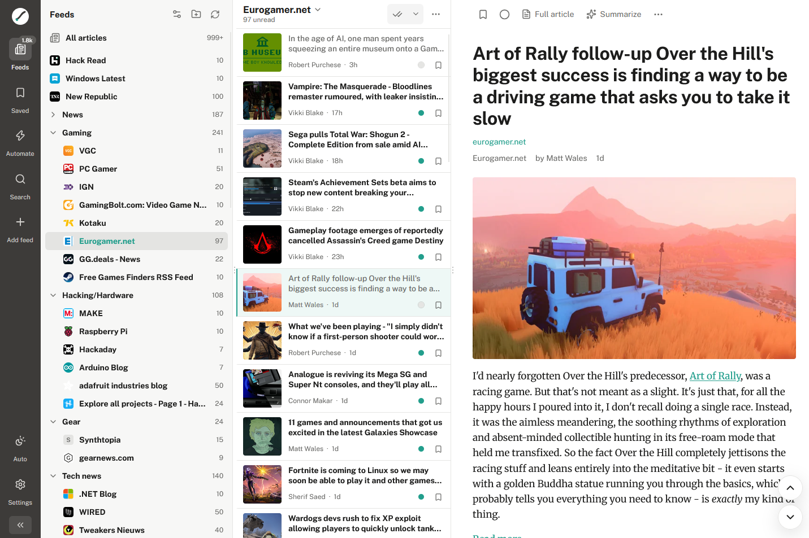

# Rivulet

A self-hosted, single-user RSS reader with a three-pane layout. Built with Next.js 16 and SQLite.



## Features

- **Feeds and folders** with unread counts, in a three-pane layout
- **Full article** fetch (Readability) for feeds that only send a teaser (works on most, not all, websites)
- **AI summaries** via OpenRouter, cached per article
- **Saved for later** and **full-text search**
- **Monitoring feeds**: saved keyword searches that act like feeds
- **Automations**: email (SendGrid) or push (Pushover) when a new article matches your conditions
- **Filters**: hide matching articles, or keep only matching ones, per feed or folder
- **Read state**: marked read on open; mark a whole section read, or only older items
- **OPML** import and export
- **Background refresh** with conditional GET and automatic cleanup of old read articles
- **Light and dark themes**, on desktop and mobile
- **Keyboard shortcuts** (`j`/`k`, `s`, `m`, `/` and more)
- **Optional password**

## Running

```bash
npm install
cp .env.example .env   # optional: OpenRouter key, password
npm run dev            # http://localhost:3000
```

Production:

```bash
npm run build
npm start
```

The database is created at `data/reader.db` (override with `DATABASE_PATH`). Back up that file to keep your feeds, read state and saved articles.

## Docker

Images are published to `ghcr.io/wardboumans/rivulet`:

| Tag             | Built from                     |
| --------------- | ------------------------------ |
| `latest`        | `main` and every release       |
| `1.0.0`, …      | release tags                   |
| `develop`       | the `develop` branch           |
| `<short-sha>`   | a specific `develop` commit    |

To try it out (nothing is kept when you stop it):

```bash
docker run --rm -p 3000:3000 ghcr.io/wardboumans/rivulet:latest
```

Or with plain Docker:

```bash
docker run -d --name rivulet --restart unless-stopped \
  -p 3000:3000 \
  -v ./data:/data \
  ghcr.io/wardboumans/rivulet:latest
```

The database lives in `/data` inside the container, so mount a volume there (`./data` on the host above) or you lose your feeds when the container is replaced. API keys can be set as environment variables or added later under **Settings**.

To update: `docker compose pull && docker compose up -d`. To build the image from this checkout instead: `docker build -t rivulet .`

## Configuration

Most configuration lives in the app under **Settings** (`/settings`): refresh interval, retention, automatic full text, the OpenRouter key and model, and the SendGrid and Pushover credentials for rules (each with a "Send test" button). Keys saved there are stored in the database and are never sent back to the browser; the UI only shows whether a key is set and its last four characters.

Environment variables still work as a fallback for those keys, and are the only way to set the password and paths:

| Variable             | Purpose                                                              |
| -------------------- | -------------------------------------------------------------------- |
| `OPENROUTER_API_KEY` | Enables the Summarize button                                         |
| `OPENROUTER_MODEL`   | Default model slug (default `openrouter/auto`), editable in Settings |
| `SENDGRID_API_KEY`   | Enables the email action in automations                              |
| `SENDGRID_FROM`      | Verified sender address for those emails                             |
| `PUSHOVER_APP_TOKEN` | Enables the push notification action                                 |
| `PUSHOVER_USER_KEY`  | Your Pushover user (or group) key                                    |
| `APP_PASSWORD`       | Requires a password to use the app                                   |
| `DATABASE_PATH`      | SQLite file location                                                 |
| `DISABLE_SCHEDULER`  | `1` turns off background refresh                                     |

## Layout

```
src/
  app/api/…        route handlers (articles, feeds, folders, monitors, rules, filters, opml, refresh, settings, login)
  components/      client UI (AppShell holds state; Rail, SidebarPanel, ArticleList, ArticleView, Dialogs)
  lib/db.ts        schema + connection singleton
  lib/feeds.ts     discovery, parsing, refresh, retention
  lib/queries.ts   sidebar counts, article listing, mark-read
  lib/fulltext.ts  Readability extraction
  lib/summarize.ts OpenRouter streaming
  lib/opml.ts      OPML import/export
  lib/monitors.ts  monitoring-feed queries (FTS5)
  lib/automations.ts  rules: matching, SendGrid/Pushover delivery
  lib/filters.ts   remove/keep filters (hidden flag on articles)
  instrumentation.ts  starts the background scheduler
  proxy.ts         optional password gate
```
